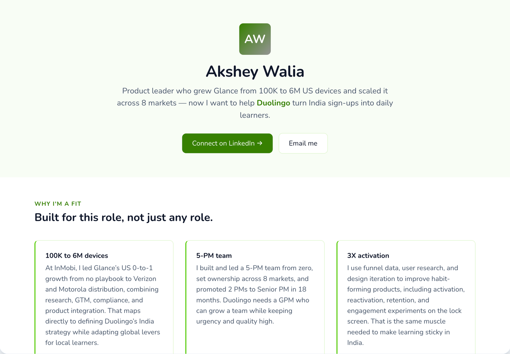

<div align="center">

# 🧲 JobMagnet: a portfolio website in the hiring company's own brand

**Paste your profile and a job link. Five OpenAI Codex agents (helpers, each with one job) build you a portfolio website in the target company's own brand, in ~96 seconds.**

[](https://jobmagnet-app.vercel.app)
[](https://github.com/aksheyw/jobmagnet-codex)
[](LICENSE)


[**→ Try the live demo**](https://jobmagnet-app.vercel.app) · [**→ Brand gallery (8 companies)**](https://jobmagnet-app.vercel.app/gallery) · [**→ A generated site (Duolingo)**](https://jobmagnet-app.vercel.app/edit/dNfNbTswsb)

<a href="https://jobmagnet-app.vercel.app/edit/dNfNbTswsb"></a>

*A real run: the Duolingo site from the link above.*

</div>

<p align="center">
  
</p>

---

## What this is

A working product, not a deck. Open the live link, paste your profile and a job URL, and ~96 seconds later you have a custom portfolio **website** themed in the target company's *real* brand colors and fonts, plus a tailored narrative and an optional PM-style product critique of the company. You download the Next.js project and deploy it to your own Vercel. **You own it; we don't host it.**

Built solo for the **OpenAI x Outskill AI Builders Hackathon**. The interesting part isn't another GPT wrapper but **five specialized Codex SDK agents** orchestrated end-to-end, using real `web_search`, strict JSON-schema output, and a sandboxed workspace.

I wrote up why I built it this way, and what I left out on purpose, in [CASE-STUDY.md](CASE-STUDY.md).

## How it is built

<details>
<summary>📋 <b>Every live link: the app, the gallery, the telemetry and three demo sites</b></summary>

<br>

| | Link |
|---|---|
| **Live app** | https://jobmagnet-app.vercel.app |
| **Brand gallery**: 8 companies, 5 distinct design systems (Duolingo is a real generation; the rest are illustrative) | https://jobmagnet-app.vercel.app/gallery |
| **Codex usage**: live agent telemetry | https://jobmagnet-app.vercel.app/usage |
| **Demo: Duolingo** (systematic green; Builder pitch) | https://jobmagnet-app.vercel.app/edit/dNfNbTswsb |
| **Demo: Sarvam** (minimal, lavender) | https://jobmagnet-app.vercel.app/edit/ptc4NPeQ6G |
| **Demo: Stripe** (Strategist pitch) | https://jobmagnet-app.vercel.app/edit/PxFgzb9RUh |
| **Engine-room health** | https://jobmagnet-codex.aksheywalia.in/health |

</details>

<details>
<summary>🔍 <b>The numbers, and where they come from</b></summary>

<br>

| Metric | JobMagnet |
|---|---|
| Time to a deployable, on-brand site | **~96 seconds** end-to-end |
| Codex agents in the pipeline | **5**: Research · Brand · Narrative · Pitch · Code |
| Token cost (MVP) | runs on the Codex CLI's **ChatGPT Plus OAuth**: no per-token API cost during the hackathon; production would use an OpenAI API key |
| Brand accuracy | the target company's *actual* colors + fonts, extracted live (Brandfetch → Codex `web_search` fallback) |
| Per-company look | one résumé across **8 companies and 5 distinct design systems**: the mood and the layout change, not just the accent color ([see the gallery](https://jobmagnet-app.vercel.app/gallery)) |

Token + duration is logged to Supabase `codex_usage`, so these are measured, not estimated. (The Duolingo demo above: Research ≈ 24K in / 0.7K out, 19s · Brand 0 tokens via Brandfetch, 1s · Narrative ≈ 17K / 1.5K, 30s · Pitch ≈ 25K / 3.9K, 79s · Code = deterministic, 0 tokens.)

</details>

<details>
<summary>🌉 <b>How the two repos talk</b></summary>

<br>

> **Two repos, one product.** This repo (`jobmagnet-app`) is the **Next.js UI + API on Vercel**. The Codex agent runtime lives in the **[jobmagnet-codex](https://github.com/aksheyw/jobmagnet-codex)** "engine room", which runs on a VPS.

The app never imports `@openai/codex-sdk`. It inserts a job row, fires a fire-and-forget `POST /orchestrate` at the VPS (HTTPS bearer auth over a Cloudflare Tunnel), then polls Supabase for per-agent progress. The download streams from the VPS via an HMAC-signed URL. Three clouds: **Vercel** (UI + API), **Hostinger VPS** (Codex runtime), **Supabase** (Postgres telemetry + content). All at **no incremental infra cost** (pre-existing / free-tier).

</details>

<details>
<summary>🔧 <b>How we used the Codex SDK</b></summary>

<br>

This is the part that matters for an OpenAI hackathon: not a thin wrapper, but deep, multi-agent use of `@openai/codex-sdk` (v0.133):

- **5 specialized agents**, each with its own prompt, schema, and tool set, orchestrated end-to-end (not one mega-prompt).
- **Live `web_search` + network access** on the Research, Brand, and Pitch agents to fetch real page content.
- **Strict structured output**: 4 of 5 agents use `outputSchema` (JSON Schema), so we trust the shape instead of regex-parsing prose.
- **Sandboxed workspace**: the Pitch agent runs `workspace-write`; the Code agent copies a Next.js template, rewrites the Tailwind config + `next/font` imports + content JSON, assembles, and zips it deterministically (0 LLM tokens). The downloaded project is a standard Next.js app you build + deploy yourself.
- **Auth (MVP):** generations run via the Codex CLI's **ChatGPT Plus OAuth**, so there's no per-token API cost during the hackathon. Production would use an OpenAI API key.

</details>

<details>
<summary>📄 <b>Engineering decisions worth calling out</b></summary>

<br>

1. **The Codex runtime runs on a VPS, the UI on Vercel.** The agent runtime lives on a Hostinger VPS (Docker, Cloudflare Tunnel) while the UI/API stays on Vercel. Two deploy targets, one product. ([jobmagnet-codex →](https://github.com/aksheyw/jobmagnet-codex))
2. **Five specialized agents instead of one mega-prompt.** Each agent is independently inspectable in `codex_usage`.
3. **Brandfetch → Codex `web_search` cascade.** Brandfetch nails well-known companies; the Codex fallback (with live search) catches the long tail. Two paths, one `BrandStyle` schema.
4. **You own the output.** We don't host generated sites: you download a real Next.js project and deploy it to *your* Vercel. No lock-in, no per-tenant infra to run.
5. **Security at the boundary.** User-supplied URLs pass an SSRF guard (no `file://`, no internal IPs); downloads are HMAC-signed with an expiry; the bridge is bearer-authed + rate-limited.

</details>

<details>
<summary>📦 <b>Tech stack, and running it locally</b></summary>

<br>

| Layer | Choice |
|---|---|
| Framework | **Next.js 16** (App Router) + **React 19** |
| Styling | **Tailwind CSS 4** + **shadcn/ui** (`base-nova`) |
| API | Next.js route handlers (Node runtime) |
| Data | **Supabase** Postgres (RLS): `profiles`, `generation_jobs`, `generations`, `brand_cache`, `codex_usage` |
| Validation | **Zod 4** on every POST body |
| Bridge | `fetch()` → **jobmagnet-codex** over Cloudflare Tunnel + HTTPS bearer auth |
| Hosting | **Vercel** (auto-deploy from `main`) |

**Run locally**

```bash
git clone https://github.com/aksheyw/jobmagnet-app.git
cd jobmagnet-app
pnpm install

# Create .env.local with the values the app needs:
#   - Supabase project URL + service-role key
#   - the jobmagnet-codex bridge URL + its shared bearer secret
# (The agent runtime lives in github.com/aksheyw/jobmagnet-codex.)

pnpm dev   # http://localhost:3000
```

Generation requires a running **jobmagnet-codex** instance (the Codex agent runtime). The UI runs standalone against existing Supabase rows without it.

</details>

<details>
<summary>⏳ <b>Scope: what the MVP includes, and what is deferred</b></summary>

<br>

The deliverable is the **portfolio website**. Intentional MVP scope cuts: LinkedIn-PDF parsing, magic-link email, `.docx`/PDF résumé + cover-letter *downloads*, and a 2nd template.

</details>

## License

[MIT](LICENSE). © 2026 Akshey Walia

---

<div align="center">

**Built by [Akshey Walia](https://www.linkedin.com/in/aksheywalia/)** · [LinkedIn](https://www.linkedin.com/in/aksheywalia/) · [aksheywalia.in](https://aksheywalia.in)

*The Codex agent runtime that powers this lives in [jobmagnet-codex](https://github.com/aksheyw/jobmagnet-codex).*

</div>
